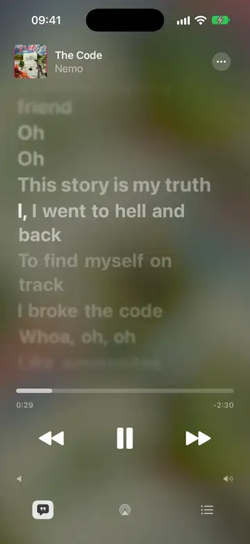
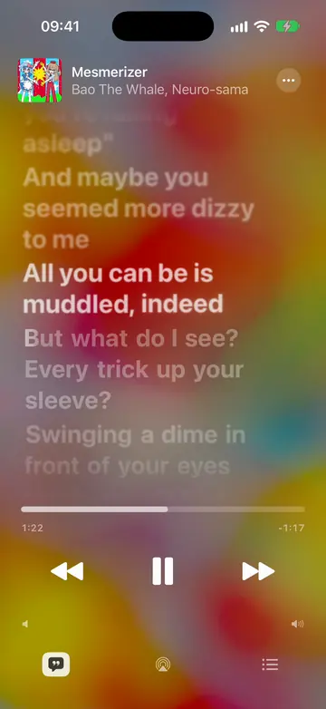
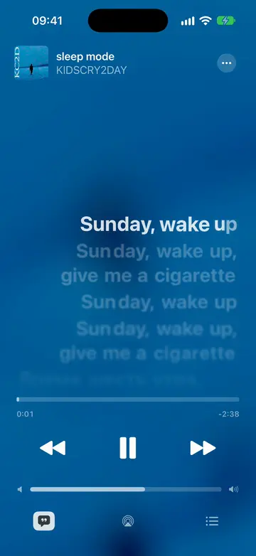
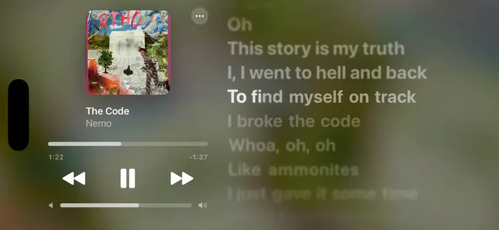
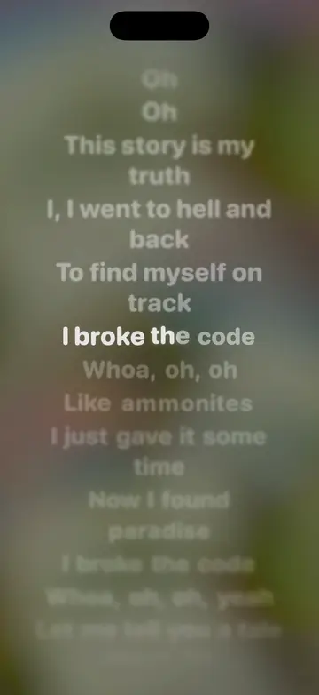
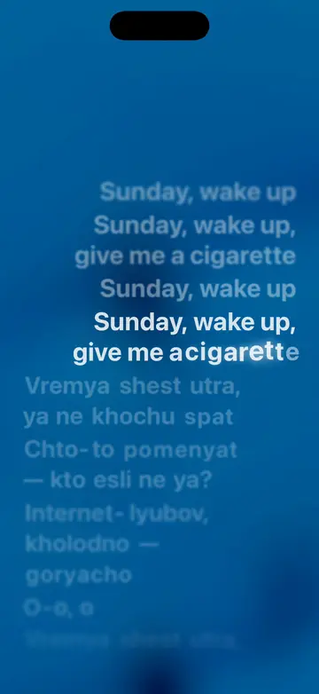
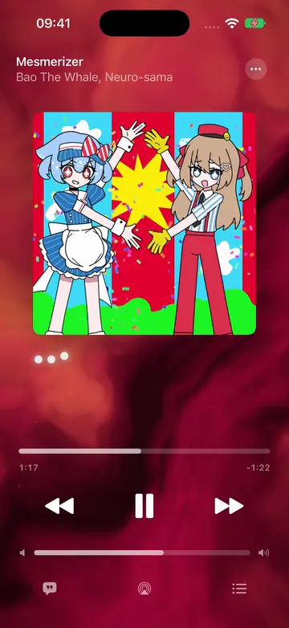
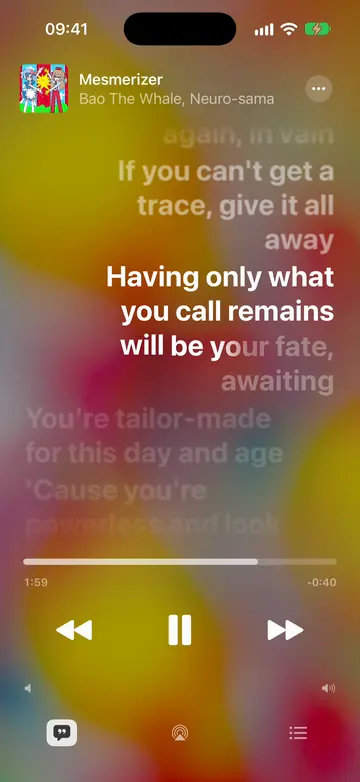
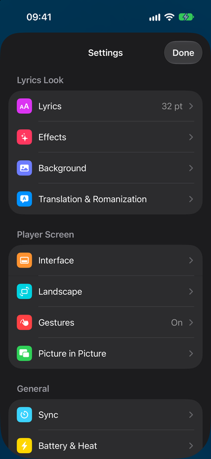

# Spicy Lyrics for iOS (Unofficial Port)

> **Usable, but still rough.**
> Past the first prototype: the app installs, follows Spotify, and shows word-synced lyrics
> day to day. It is still raw, though. Expect bugs, rough edges, missing polish and settings
> that change between versions. Please report what breaks.

A standalone iOS app that displays **word-by-word synchronized lyrics** for songs playing
on Spotify. It ports the [Spicy Lyrics](https://github.com/Spikerko/spicy-lyrics)
Spicetify extension, taking inspiration from the Android app
[spicylyrics/mobile](https://github.com/spicylyrics/mobile).

Made by **[sppq](https://spicylyrics.org/sppq)** ([GitHub](https://github.com/Sppqq)), tested by
**[nie4ick](https://spicylyrics.org/nie4ick)**.

## In Action

<p align="center">
  
  
  
</p>
<p align="center"><sub>Word by word over the cover · duets, each voice on its own side · an Apple Music style player</sub></p>

<p align="center">
  
</p>
<p align="center"><sub>Landscape</sub></p>

<p align="center">
  
  
</p>
<p align="center"><sub>Make it yours: font, weight, size, alignment, blur, glow, background · romanization (Cyrillic, Japanese, Korean, Chinese, Greek)</sub></p>

<p align="center">
  
  
  
</p>
<p align="center"><sub>Big artwork with the line under it · Simple Lyrics Mode · plenty of settings</sub></p>

<sub>Recorded in the iOS Simulator with the Debug-only demo mode (`SpicyLyrics/Support/DemoMode.swift`).
Songs: Nemo — The Code, Bao The Whale &amp; Neuro-sama — Mesmerizer, KIDSCRY2DAY — sleep mode. On a phone
the app follows Spotify instead. On-device translation (iOS 18+) and
Picture in Picture work on a phone only.</sub>

## Install

The app is not on the App Store: you sideload it with **AltStore** or **SideStore** and get
updates from this repository's source, like from an App Store page.

**You need:** an iPhone or iPad on **iOS 17** or newer, the Spotify app with **Premium**, and a
computer for the first AltStore / SideStore setup (Windows or Mac; SideStore needs it only once).

### 1. Install AltStore or SideStore

- **AltStore** — [altstore.io](https://altstore.io): install AltServer on your computer and
  follow its guide to put AltStore on the phone.
- **SideStore** — [sidestore.io](https://sidestore.io): after the one-time setup it signs and
  refreshes apps on the phone itself, no computer nearby.

### 2. Add the Spicy Lyrics source

| Channel | What you get | Source URL |
| --- | --- | --- |
| **Stable** (recommended) | Tested releases | `https://github.com/Sppqq/spicy-lyrics-ios/releases/latest/download/altstore-source.json` |
| **Alpha & Beta** | Every build from `main`, the newest first (can be rough) | `https://github.com/Sppqq/spicy-lyrics-ios/releases/latest/download/altstore-source-testing.json` |

Copy a URL, then in AltStore or SideStore open **Sources → +**, paste it and tap **Add**.
Both channels install the same app, so add **one** of them.

### 3. Install the app

Open the source, tap **Spicy Lyrics → Free / Install** and wait for it to sign and install.

### 4. First launch: connect Spotify

Spotify lets every developer app sign in only 5 accounts, so the app uses **your own** free
Spotify developer app. It walks you through it on first launch (about two minutes); the steps
are also under [Who can sign in](#who-can-sign-in). For the exact timing from the Spotify app on
the same phone (App Remote):

1. In your app on [developer.spotify.com](https://developer.spotify.com/dashboard) →
   **Settings**, tick **iOS** as well.
2. Add the **Bundle ID** shown in Spicy Lyrics → *Settings → Sync → If it won't connect*
   (AltStore and SideStore change it when they install) and the redirect URI
   `spicylyrics-ios://callback`.
3. Sign in once more in Spicy Lyrics if it says so.

### Updates

AltStore / SideStore check the source and show **Update** under **My Apps** when a new version
is out (*Update All* updates everything at once). What's new is in each
[release](https://github.com/Sppqq/spicy-lyrics-ios/releases). Your settings and sign-in stay.

### Keep it running

A free Apple ID signs apps for **7 days**. AltStore refreshes them in the background while
AltServer runs on the same Wi-Fi; SideStore refreshes on the phone. If the app stops opening,
open AltStore / SideStore → **My Apps → Refresh All**. A free Apple ID can also have only
3 sideloaded apps at a time.

### Without AltStore

Every [release](https://github.com/Sppqq/spicy-lyrics-ios/releases) has an unsigned
`SpicyLyrics-<version>-unsigned.ipa`; sign it with any sideloading tool (Sideloadly, a paid
developer account, …). Or [build it yourself](#building).

### Troubleshooting

- **The app doesn't open after a week** — refresh it (see above).
- **"INVALID_CLIENT" or a 403 when signing in** — the Client ID, redirect URI or User Management
  entry in your Spotify developer app is off; see [Who can sign in](#who-can-sign-in).
- **The sync badge says "SDK: sign in again"** — your login predates App Remote: sign in again.
- **"SDK: no link"** — Spotify must be playing on this phone; check step 4, then tap the badge →
  *Open Spotify and Connect*.
- **Something else** — *Settings → Log → Share Log File*, and open an
  [issue](https://github.com/Sppqq/spicy-lyrics-ios/issues) with it.

## Ported Features

These features work, but still need testing and refinement.

| Feature | iOS implementation |
| --- | --- |
| Word-by-word highlighting | Port of `LyricsAnimator.ts`: NotSung/Active/Sung states, syllable gradients, cubic splines for scale/y-offset/glow, and [spr](https://github.com/Fraktality/spr) springs |
| Per-letter animation | Syllables longer than one second are split into letters with a proximity effect, following `Emphasize.ts` |
| Line blur | Blur increases with distance from the active line (`BlurMultiplier = 1.25`) |
| Duets and backing vocals | Right-aligned `OppositeAligned` lines; each backing-vocal group is its own smaller row under the main line (`bg-line`), so two can follow each other |
| Instrumental breaks | Three animated dots during gaps of at least three seconds |
| Line-synced and static lyrics | `Line` and `Static` lyric types |
| Dynamic background | Port of the extension's Kawarp: the blurred cover warped like liquid by drifting noise, cross-fading from song to song and slowing down on pause. A Metal shader drawn at the original's 300×150 and stretched, so it stays light on battery |
| Big artwork | The quote button at the bottom left swaps the lyrics for the cover, as big as fits, over a flowing nebula in the cover's colours, with the line being sung under it (word by word, like the lyrics). Songs whose lyrics are hidden can show it too, or the nebula alone |
| Skip songs without sync | Optionally skips songs that have no Spicy Lyrics sync (or no word-by-word sync). The next songs in the queue are looked up while the current one plays, so an unsynced song is skipped the moment it starts, together with any unsynced songs right after it; songs you pick or go back to are kept |
| Lyrics ahead of time | The lyrics of the next songs in the queue are fetched while the current one plays, so they show the moment the song changes |
| Lyrics sources | Spicy Lyrics API with [LRCLIB](https://lrclib.net) as a fallback |
| Romanization | Supported when returned by the API (`TransliteratedText`) |
| Seeking | Tap a lyric line to seek to it; requires Spotify Premium |
| Track picker | Tap the track header (or the list button) to jump ahead in the queue, replay something from your history, or search; swipe the header sideways to skip. Requires Spotify Premium |
| Own TTML files | Like the extension's Lyrics Manager: pick a `.ttml` file or paste TTML, apply it just once or save it to a library that wins over online sources (*••• → Свой текст (TTML)*) |
| Apple Music style player | Controls fade away while a song plays; landscape and iPad put artwork and controls beside the lyrics |
| Gestures | Swipe the lyrics sideways to change tracks, pinch to resize, long-press a line to seek / copy / share (iOS 18+) |
| iPad | Side-by-side layout in both orientations, larger lyrics, pointer hover, keyboard shortcuts (space, ⌘← / ⌘→) |
| Floating lyrics (Picture in Picture) | The current line, word by word, in a PiP window over any app; wide, square, portrait or tall; opens out of the lyrics and closes back onto them; starts from *•••* or when leaving the app; play/pause and ±15 s from the window |
| Romanization and translation | On-device: Japanese (with kanji readings), Chinese pinyin, Korean, Cyrillic, Greek; translation under or instead of each line, by Apple Translation on the device (iOS 18+), Google, Yandex or DeepL (your own key) |
| Interface language | English and Russian; follows the phone's language (English otherwise), or pick one in *Settings → Interface* |
| Display modes | Spicy Lyrics' Simple Lyrics Mode, centred lyrics, SF Pro / Rounded / New York |

## Spotify Connection

The app connects through the official **Spotify Web API**:

- OAuth sign-in using Authorization Code + PKCE, without a client secret.
- Requests to `/me/player` every 2 seconds while playing (sooner near the end of a track and
  right after a button press). Between requests, playback position is estimated locally; small
  differences are blended in gradually (median of recent polls) so words never jump backwards,
  and a position that stops moving is treated as paused even if Spotify still reports `is_playing`.
- Transient connection failures (TLS handshake errors, dropped VPN connections) are retried
  on a fresh connection.
- Play/pause, next/previous, and seeking through the Web API; these controls require
  **Spotify Premium**.

### Who can sign in

Spotify keeps every developer app in **Development Mode** unless the developer is an
organization with 250,000+ monthly users, and a Development Mode app accepts at most
**5 allowlisted accounts**; the app owner also needs Premium. The same applies to the iOS SDK.
So the app ships **without a Client ID of its own**: everyone signs in with **their own Client
ID**, and the app walks them through it on first launch (*Settings → Spotify* to change it):

1. You need **Spotify Premium** (Spotify requires it from the owner of a developer app).
2. Open the [Spotify Developer Dashboard](https://developer.spotify.com/dashboard), sign in with
   your Spotify account and accept the terms.
3. **Create app**: any name and description, website empty, redirect URI
   `spicylyrics-ios://callback` (press **Add**), tick **Web API**, accept, **Save**.
4. **Settings → User Management → Add new user** with your Spotify account's email
   (up to five people can share your Client ID this way).
5. **Basic Information → Client ID**: copy it (not the client secret) and paste it into the app.

If an account that isn't in your app's User Management list signs in, Spotify answers 403; the
app then explains how to add it. A quota 429 (`QUOTA_EXCEEDED`) is reported too.

## Lyrics Source: Spicy Lyrics Key

- **With a key (recommended):** obtain a client key (`sl_pk_…`) from
  [Spicy Lyrics Developers](https://developers.spicylyrics.org) and enter it under
  *Settings → Lyrics Sources*. The app uses `GET /v1/lyrics/{trackId}`, as the Android app does.
- **Without a key:** the app sends a `POST /query` request using your Spotify token,
  following the Spicetify extension. SLObjPack responses are decoded on the device.
  The server may reject tokens from third-party apps. If that happens, the app prompts
  you to add a key and falls back to LRCLIB for line-synced lyrics.

## Built-in Key

The Spicy Lyrics client key (`sl_pk_…`) can be built into the app, so users skip that setup and
cannot change it. A Spotify Client ID is never built in (see *Who can sign in*).

- **Locally:** copy `Config/Secrets.example.xcconfig` to `Config/Secrets.xcconfig` (git-ignored)
  and fill it in.
- **GitHub Actions:** add the repository secret `SPICY_LYRICS_KEY`.

`scripts/generate-bundled-keys.sh` turns it into a git-ignored Swift file with the value
XOR-masked, so it is not readable in `Info.plist` or the binary's strings. This only deters
casual inspection: it is a public client key that the app sends over the network anyway.
Never put a Spicy Lyrics secret key (`sl_sk_…`) there.

## Building

Requires a Mac with Xcode 16+ targeting iOS 17+, **or** GitHub Actions.
Build and installation paths are experimental at this stage.

### On a Mac

```bash
brew install xcodegen
xcodegen generate
open SpicyLyrics.xcodeproj
```

Select your development team in Xcode under **Signing & Capabilities**. If the bundle
identifier is unavailable, change `PRODUCT_BUNDLE_IDENTIFIER` in `project.yml`.
Then build and run the app on your iPhone.

### Without a Mac: GitHub Actions and Sideloading

The workflow in `.github/workflows/ios-build.yml` builds an **unsigned** IPA on a macOS
runner. What it publishes depends on how it runs:

| Trigger | Channel | Result |
| --- | --- | --- |
| Pull request | `pr` | Compile check; IPA only as a run artifact |
| Push or merge to `main` | `alpha` | Pre-release `vX.Y.Z-alpha.N` under *Releases* (the last 10 are kept) |
| *Actions → Build iOS app → Run workflow* on `main` | `release` | Stable release `vX.Y.Z` under *Releases* |

Versioning:

- Stable versions are git tags `vX.Y.Z`. A manual run raises the latest one by the chosen
  part (`patch` by default, or `minor` / `major`), or uses the exact version you type in.
- Alphas carry the version of the next patch release plus the run number, e.g. `v0.1.1-alpha.57`.
- `MARKETING_VERSION` in `project.yml` is the floor: with no tags yet the first release uses it,
  and raising it (say to `1.0.0`) moves every following build to that line.
- The build number (`CFBundleVersion`) is the workflow run number, so it always grows.
- The app shows its version and channel under *Settings → About*.

To install, download the IPA from the release (or the run's artifacts) and sign it with
[Sideloadly](https://sideloadly.io) or [AltStore](https://altstore.io) using your Apple ID.
With a free account, the installation has to be refreshed every seven days.

## Project Structure

```text
SpicyLyrics/
  App/          Entry point and lifecycle; polling while the app is open
  Spotify/      OAuth PKCE, Web API, player model, and playback clock
  Lyrics/       Models, parsers (Spicy JSON, LRC), SLObjPack, service, and disk cache
  Rendering/    Springs, splines, animator, lyric line rendering, and scrolling
  Background/   Kawarp background and visualizer (Metal)
  UI/           Onboarding, now playing screen, playback controls, and settings
```

## Current Limitations

- **Still raw:** expect bugs and rough edges; features, UI, and integrations may change between versions.
- Spotify is followed while the app is open or its Picture in Picture window is up; not in the background otherwise.
- Playback controls require Spotify Premium.
- Genius integration is not supported in this version.

## License and Credits

- Author: [sppq](https://spicylyrics.org/sppq) · [github.com/Sppqq](https://github.com/Sppqq)
- Tester: [nie4ick](https://spicylyrics.org/nie4ick)
- Original extension: [Spicy Lyrics](https://github.com/Spikerko/spicy-lyrics) by Spikerko

Licensed under **AGPL-3.0**, following the original projects. See [LICENSE](LICENSE).
This is an unofficial project and is not affiliated with Spotify AB or the creators of Spicy Lyrics.
